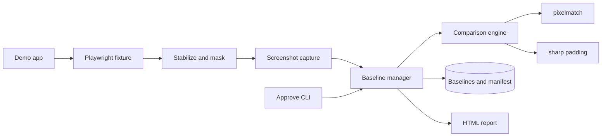
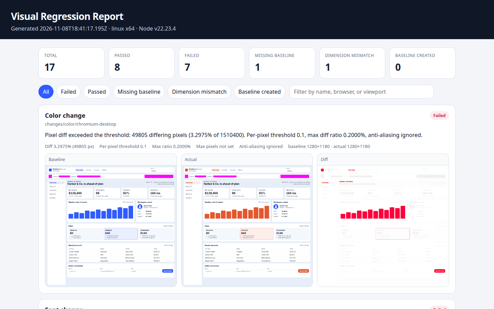
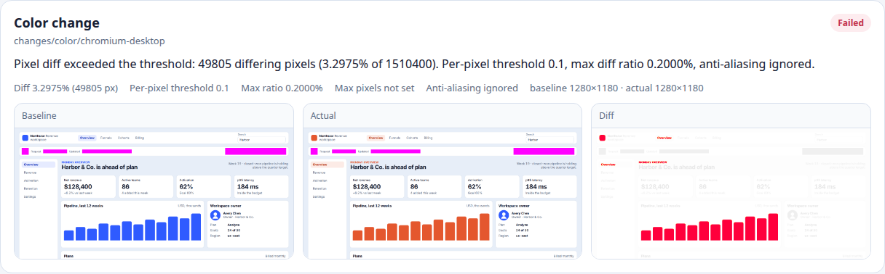
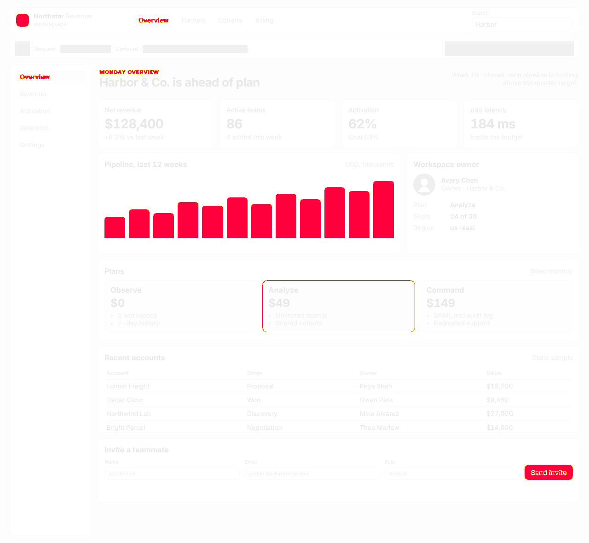

# Visual Regression Testing Framework

[](https://github.com/hassanmehmoodd/visual-regression-testing-framework/actions/workflows/visual-regression.yml)
[](https://nodejs.org/)
[](https://playwright.dev/)
[](LICENSE)

A reusable visual regression framework for TypeScript. It captures full-page, element, viewport, responsive, and per-browser screenshots with Playwright, compares them with a pixelmatch engine, and keeps approved baselines under explicit human control.

A failing check never overwrites an approved baseline. A missing baseline is saved as a pending candidate and fails the check, unless update mode is turned on for that first creation.

## Features

- Full-page, element, and viewport screenshots, named `suite/test/browser-viewport.png`
- Chromium, Firefox, and WebKit, with desktop, tablet, and mobile viewports
- Pixel comparison with a per-pixel threshold, a max diff ratio, an optional pixel cap, and anti-aliasing tolerance
- Dimension-mismatch detection, with an optional padded diff produced by sharp
- Manual baseline approval, archived history, and a manifest of hash, timestamp, and approver
- Masking for timestamps, random ids, avatars, ads, and any other selector you configure
- Stabilization without sleeps: network idle, required elements, finished animations, `document.fonts.ready`, and image decode
- A self-contained HTML report with summary counts, filters, and embedded images
- A local demo application and a GitHub Actions workflow that fails the build when a check exceeds its threshold

## Architecture



The modules under `src/` are the reusable part. The demo, sample tests, and committed baselines show the framework running against a local page. See [docs/ARCHITECTURE.md](docs/ARCHITECTURE.md) for the comparison rules and baseline lifecycle.

## Folder structure

```text
src/
  comparison/        PNG decode, sharp padding, pixelmatch engine
  baseline/          Paths, manifest, history, approval, verify
  capture/           Stabilization and screenshot capture
  report/            Result files and the self-contained HTML report
  fixtures/          Playwright visual fixture
  cli/               baseline:approve and baseline:verify
  config/            Defaults, environment overrides, browser selection
demo/                Local Northstar dashboard
tests/unit/          Comparison, baseline, report, and CLI tests
tests/visual/        Runnable visual checks against the demo
tests/report/        Parses the generated HTML report
baselines/           Approved screenshots plus manifest.json
docs/examples/       Committed report and real diff images
.github/workflows/   ubuntu-24.04 visual regression job
```

## Install

Requires Node.js 22 or newer.

```bash
git clone https://github.com/hassanmehmoodd/visual-regression-testing-framework.git
cd visual-regression-testing-framework
npm ci
npx playwright install --with-deps chromium firefox webkit
```

On Linux, `--with-deps` installs the system libraries Playwright needs for Chromium, Firefox, and WebKit.

## Run

```bash
npm test                  # unit tests, then the visual suite
npm run test:unit         # comparison engine, baseline manager, report, CLI
npm run test:visual       # Playwright projects: chromium, firefox, webkit, report
npm run demo              # http://127.0.0.1:4173
npm run lint
npm run typecheck
npm run baseline:verify
```

`npm test` starts the demo through Playwright's `webServer`. It does not call any third-party site.

Open a changed variant while the demo is running:

```text
http://127.0.0.1:4173/?variant=color
http://127.0.0.1:4173/?variant=font
http://127.0.0.1:4173/?variant=spacing
http://127.0.0.1:4173/?variant=size
http://127.0.0.1:4173/?variant=layout
http://127.0.0.1:4173/?variant=missing
```

`VRT_DEMO_VARIANT` is used only when the request has no `variant` query parameter.

## Usage

```ts
import { expect, test } from './src/fixtures/visual';

test('dashboard matches the approved baseline', async ({ visual }) => {
  const result = await visual.check({
    suite: 'dashboard',
    name: 'full-page',
    viewport: 'desktop',
    fullPage: true,
    goto: '/',
  });

  expect(result.status).toBe('passed');
});
```

`visual.check` returns the comparison instead of throwing, so a test can expect a detected failure. `visual.capture` returns the PNG buffer after the same stabilization and masking.

Screenshot files are stored as:

```text
<suite>/<name>/<browser>-<viewport>.png
```

Example: `dashboard/full-page/firefox-desktop.png`.

A check passes only when the diff ratio is within `maxDiffPixelRatio` and, if `maxDiffPixels` is set, the diff count is within that cap too. Both budgets have to hold.

## Baseline workflow

1. Run the suite. A missing baseline is written to `test-results/visual/pending/` and the check status is `missing-baseline`. The test fails if it expected `passed`.
2. Review the pending or actual PNG.
3. Approve it. This is the only path that replaces an approved file:

```bash
npm run baseline:approve -- \
  --test dashboard/full-page \
  --browser chromium \
  --viewport desktop \
  --approver "Your Name"
```

`--source` is `actual` (default), `pending`, or a PNG path. Approval copies the previous baseline into `baselines/history/`, writes the new file, and records the sha256, pixel size, timestamp, approver, and version in `baselines/manifest.json`.

`VRT_UPDATE_BASELINES=1` creates a baseline only when one does not exist yet. It does not replace a baseline that is already on disk, including when the new screenshot fails the threshold. `npm run test:visual:update` uses that mode for the stable demo screenshots.

```bash
npm run baseline:approve -- --list
npm run baseline:verify
```

## Configuration

Defaults live in [`vrt.config.ts`](vrt.config.ts). Environment variables override them. `.env.example` lists every variable. Nothing loads that file automatically; export the variables you want.

| Variable | Purpose |
| --- | --- |
| `VRT_UPDATE_BASELINES` | Create missing baselines. Does not overwrite approved ones. |
| `VRT_THRESHOLD` | pixelmatch color distance, 0 to 1. Default `0.1`. |
| `VRT_MAX_DIFF_RATIO` | Maximum fraction of pixels that may differ. Default `0.002`. |
| `VRT_MAX_DIFF_PIXELS` | Optional pixel cap. When set, both the ratio and the cap must pass. |
| `VRT_IGNORE_ANTIALIASING` | Ignore pixels pixelmatch classifies as anti-aliased. |
| `VRT_PAD_DIMENSION_MISMATCH` | Write a padded diff when sizes differ. The check still fails. |
| `VRT_INCLUDE_PLATFORM` | Add the OS to the file name, for example `chromium-desktop-linux.png`. |
| `VRT_BROWSERS` | Comma-separated `chromium`, `firefox`, `webkit`. |
| `VRT_VIEWPORT_DESKTOP` | `1280x800`. Tablet and mobile have the same form. |
| `VRT_APPROVER` | Name stored when update mode creates a baseline. |
| `VRT_MASKS` | Comma-separated selectors that replace the config masks. |
| `PORT` | Demo server port. Default `4173`. |

Per-check options on `visual.check` override the config for that call: `threshold`, `maxDiffPixelRatio`, `maxDiffPixels`, `ignoreAntialiasing`, `masks`, `viewport`, and `baseline`.

## Platform caveat

These baselines were generated on Ubuntu 24.04 x64 with Playwright 1.65.0. File names do not include an OS suffix. A baseline produced on macOS or Windows will not match this set, because browser builds and font rasterizers differ.

CI is pinned to `ubuntu-24.04` for that reason. Set `VRT_INCLUDE_PLATFORM=true` when you need to keep more than one operating system side by side. Regenerate baselines with `npm run test:visual:update` only for screenshots that do not have an approved file yet; use `baseline:approve` to replace one.

## Example report

The committed report and diff images were produced by the local suite on Ubuntu 24.04.5, Node v22.23.4, and Playwright 1.65.0. The report recorded 17 checks: 8 passed, 7 failed, 1 missing baseline, 1 dimension mismatch, and 0 baseline created. Matching screenshots differed by 0 pixels. The failures below are expected detections, and the tests assert those statuses.

| Check | Status | Diff |
| --- | --- | --- |
| Color | failed | 49,805 px, 3.2975% |
| Font | failed | 51,919 px, 3.4374% |
| Spacing | failed | 117,773 px, 7.7975% |
| Component size | failed | 9,935 px, 0.6578% |
| Layout | failed | 167,215 px, 11.0709% |
| Missing element | failed | 51,069 px, 3.3812% |
| Strict threshold | failed | 93,440 px, 6.1864% |
| Loose threshold | passed | same 93,440 px, allowed by the per-check ratio |
| Dimension mismatch | dimension-mismatch | baseline 48×48, actual 1280×800 |







More images from that same run:

- [Self-contained HTML report](docs/examples/report.html)
- [Color baseline](docs/examples/diffs/color-baseline.png), [actual](docs/examples/diffs/color-actual.png), [diff](docs/examples/diffs/color-diff.png)
- [Font diff](docs/examples/diffs/font-diff.png)
- [Spacing diff](docs/examples/diffs/spacing-diff.png)
- [Size diff](docs/examples/diffs/size-diff.png)
- [Layout diff](docs/examples/diffs/layout-diff.png)
- [Missing-element diff](docs/examples/diffs/missing-diff.png)

Magenta rectangles in the screenshots are the masked session id, timestamp, avatar, and ad. Playwright paints those boxes before the PNG is saved, so the changing text is not part of the comparison.

`npm run docs:export` refreshes `docs/examples` and `docs/images` from the latest local run.

## Local verification

On Ubuntu 24.04.5 with Node v22.23.4:

- `npm run test:unit`: 18 passed, 0 failed
- `npm run test:visual`: 18 passed, 0 failed
  - chromium: 15 passed
  - firefox: 1 passed
  - webkit: 1 passed
  - report: 1 passed

The visual tests assert the negative cases. A detected color change, missing baseline, or dimension mismatch makes that test pass.

## Troubleshooting

See [docs/TROUBLESHOOTING.md](docs/TROUBLESHOOTING.md).

## Fonts

The demo self-hosts Inter and Libre Baskerville under the SIL Open Font License 1.1. The license texts are in `demo/public/fonts/`.

## License

MIT. Copyright (c) 2026 Hassan Mehmood. See [LICENSE](LICENSE).
