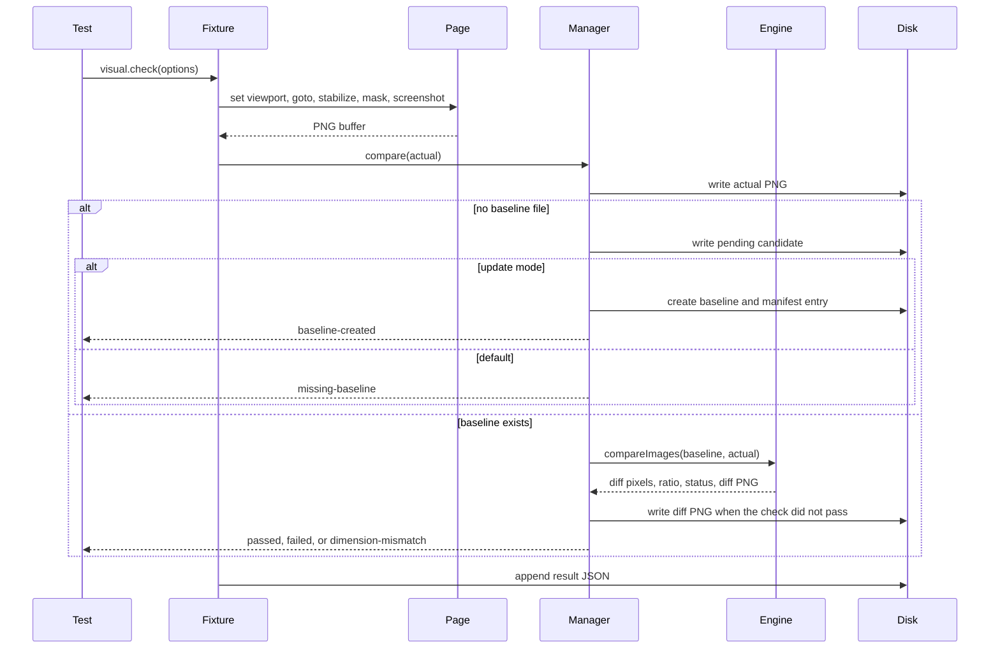

# Architecture

The framework is a library plus a sample application. Tests import the Playwright fixture. The comparison engine and baseline manager do not require a browser and are covered by Node's test runner.

## Modules

| Path | Responsibility |
| --- | --- |
| `src/comparison/engine.ts` | Compare two PNG buffers with pixelmatch. Apply the ratio budget and the optional pixel cap. |
| `src/comparison/image.ts` | Decode and encode PNGs with pngjs. Pad a smaller image with sharp. |
| `src/baseline/manager.ts` | Write actuals, detect a missing baseline, compare, approve, and verify the manifest. |
| `src/baseline/paths.ts` | Build `suite/name/browser-viewport.png`. Reject path traversal. |
| `src/baseline/manifest.ts` | Read and atomically write `manifest.json`. Append `history/log.jsonl`. |
| `src/capture/stabilize.ts` | Wait for network idle, required elements, fonts, and decoded images. Finish and disable animations. |
| `src/capture/screenshot.ts` | Full-page, viewport, or element capture, with Playwright mask locators. |
| `src/fixtures/visual.ts` | `visual.check` and `visual.capture` for Playwright tests. |
| `src/report/html-report.ts` | Self-contained HTML report. Images are embedded as base64. |
| `src/report/results-store.ts` | One JSON file per attempt. The latest attempt for each key is kept. |
| `src/cli/approve.ts` | Promote a reviewed PNG to the baseline. |
| `src/config/resolve.ts` | Merge defaults, `vrt.config.ts`, and environment variables. |
| `demo/` | Static Northstar dashboard served by Node's `http` module. |

## Request flow



A later Playwright project reads those JSON files, renders the HTML report, and asserts the summary counts, statuses, and embedded images.

## Comparison rules

pixelmatch 8 measures OKLab distance per pixel. `threshold` is that distance: `0` is strict and `1` is loose. `ignoreAntialiasing: true` maps to pixelmatch `includeAA: false`, which excludes pixels the library classifies as anti-aliased. Setting `ignoreAntialiasing` to false counts those pixels.

After the pixel count is known:

- `diffPixelRatio = diffPixels / totalPixels`
- the check fails when `diffPixelRatio > maxDiffPixelRatio`
- if `maxDiffPixels` is not null, the check also fails when `diffPixels > maxDiffPixels`
- a value equal to the budget passes

When the two images have different dimensions and `padDimensionMismatch` is true, sharp extends each image to the larger width and height. The padding is opaque magenta. pixelmatch then runs on the padded pair so a diff image can be reviewed. The status stays `dimension-mismatch` either way. Padding does not turn a size change into a pass.

## Baseline lifecycle

An approved baseline is the PNG under `baselines/` plus its entry in `baselines/manifest.json`. The entry stores the relative path, sha256, width, height, byte size, approval time, approver, version, and the OS platform string.

`BaselineManager.compare` writes the actual PNG and, when needed, a diff or a pending candidate. It does not write the baseline file. After the comparison it hashes the baseline again and throws if the bytes changed.

`BaselineManager.approve` is the controlled update:

1. Take an exclusive lock in the baseline directory.
2. If the reviewed bytes already match the current file, return without bumping the version.
3. Copy the current file to `baselines/history/<suite>/<name>/<browser-viewport>/`.
4. Replace the baseline atomically.
5. Update the manifest and append a JSON line to `baselines/history/log.jsonl`.

`verify` checks every manifest hash and dimension, and it fails if a PNG under the baseline directory is missing from the manifest. History files are excluded from that scan. Playwright's global setup runs `verify` unless update mode is on, and it clears actual, diff, pending, result, and report directories first. It refuses to clear the baseline directory.

## Screenshot identity

```text
suite/name/browser-viewport.png
```

`suite`, `name`, `browser`, and `viewport` must match `^[a-z0-9][a-z0-9_-]*$`. With `includePlatform`, the leaf becomes `browser-viewport-platform.png`.

A check can read a different baseline than the one it writes. The change tests capture `/?variant=color` under `changes/color/...` and compare those pixels with `dashboard/full-page/...`. The actual and diff stay with the change id. The approved dashboard baseline is only read.

## Stabilization and masking

Before capture, the fixture:

1. Sets the named viewport from config.
2. Navigates with `networkidle` when that wait is enabled.
3. Waits until each required selector is attached. The demo sets `[data-testid="app-ready"][data-ready="true"]` after it fills the dynamic fields.
4. Injects CSS that disables animations, transitions, and the caret, then calls `animation.finish()` on any remaining animations.
5. Awaits `document.fonts.ready` and `HTMLImageElement.decode()` for each image.
6. Passes mask locators to `page.screenshot` or `locator.screenshot`, with Playwright's `animations: 'disabled'` and `caret: 'hide'`.

There is no fixed sleep. Dynamic regions in the demo use fixed boxes so a longer random id cannot move the surrounding layout. The mask paints those boxes, which is why they are magenta in the committed screenshots.

## Demo variants

The server substitutes an allow-listed variant into `data-variant` on the HTML element. Unknown values become `stable`, so the query string cannot inject markup.

| Variant | What changes |
| --- | --- |
| `color` | Primary color, from blue to orange |
| `font` | Body font, from Inter to Libre Baskerville |
| `spacing` | Gap and card padding |
| `size` | KPI type size, logo size, and radius |
| `layout` | Sidebar and main stack vertically |
| `missing` | The pipeline chart is not displayed |

Desktop screenshots use a fixed document height so those variants change pixels without changing image dimensions. Viewports at 800px and below use a stacked document whose height follows the content. Tablet and mobile baselines are separate files.

## Report

`renderHtmlReport` sorts failures first and writes one article per check. The article exposes `data-status`, `data-key`, `data-browser`, `data-viewport`, `data-diff-ratio`, and the thresholds. The document body exposes the summary counts. A JSON island with id `vrt-results` repeats the same data for the report test. Inline script filters the cards. No remote asset is requested, so the file opens from disk.

## CI

`.github/workflows/visual-regression.yml` runs on pushes to `main` and on pull requests. Concurrency cancels an in-progress run for the same ref. The job uses `ubuntu-24.04`, caches npm and the Playwright browser directory, installs Chromium, Firefox, and WebKit with their system dependencies, then runs lint, the typecheck, and `npm test`. Screenshots and both reports are uploaded even when the job fails.

The build fails when a Playwright test fails. Sample tests that expect a detected regression fail the build only if that regression is not detected, or if a stable screenshot exceeds its threshold.
